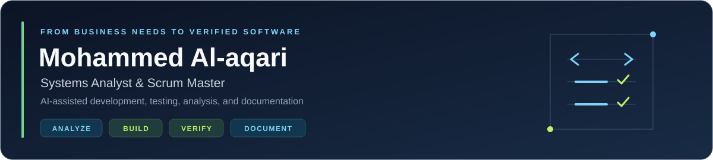

  

  
  
  

  
  
  

## About me

I use AI to **analyze systems, develop software, investigate issues, test changes, and document what I learn**.

My background connects systems analysis, requirements engineering, enterprise software, and Agile delivery. Using tools such as **OpenAI Codex**, I work from business needs and existing codebases toward clear requirements, focused implementation, and reviewed results.

I also work with **prompt engineering and locally hosted models**, exploring practical assistants and repeatable workflows for software analysis, development, testing, and documentation.

## What I focus on

| Area | Focus |
| --- | --- |
| **Systems analysis** | Business workflows, requirements, user stories, acceptance criteria, and technical documentation. |
| **Agile delivery** | Backlog clarity, sprint planning, work tracking, and connecting product needs with implementation. |
| **Enterprise software** | C# and .NET applications, ABP Framework, Angular, APIs, and layered architecture. |
| **AI-assisted engineering** | Using Codex and other AI coding tools for codebase analysis, development, debugging, testing, review, and documentation. |

## Featured project — SprintBoard

**My favorite project: bringing Agile practice into a connected web and mobile workspace.**

SprintBoard is a work-management platform built with **.NET 9, ABP Framework, Angular 19, and Flutter**. Its codebase brings together:

- Workspaces, projects, backlogs, epics, work items, and Scrum/Kanban boards.
- Sprint planning, sprint lifecycle management, releases, and time tracking.
- OKRs, reporting, workflows, customization, and CRM modules.
- Web and mobile interfaces, including the **SprintBoard Pulse** mobile experience.

It is where I bring my analysis and Scrum background into practical engineering: using AI to understand requirements, develop features, investigate defects, review changes, and improve documentation and verification.

**Repository:** `sprint_borad` · Private source code

## Technology stack

### Languages

### Enterprise backend and APIs

### Web and mobile

### Data, identity, and real-time services

### AI and coding assistants

### Developer tools and documentation

**Engineering practices:** Requirements engineering · Scrum · Domain-Driven Design (DDD) · Clean Architecture · Layered architecture · API analysis · Test design · Reusable prompts and agent skills · Arabic/English documentation

## Professional projects

### YeahMoney — ياه موني

A payments-platform project connecting financial-service workflows with API analysis, integration documentation, and identity and access requirements. My related repositories include `Yeah-Money-proj` and `YeahMoney_with_Keycloak_IAM`, covering documentation and integration-analysis work.

### ANA — Trusted Digital Identity Platform

A digital identity and eKYC platform for identity verification and access to digital services. It connects identity and onboarding needs with a shared digital experience.

[Google Play](https://play.google.com/store/apps/details?id=ana.app.ekyc) · [App Store](https://apps.apple.com/us/app/ana-platform/id1661473748)

### Bas Superapp

A unified app for everyday services, bringing shopping, food orders, bill payments, and other services into one experience.

[Google Play](https://play.google.com/store/apps/details?id=com.superstore.basapp) · [App Store](https://apps.apple.com/us/app/bas-super-app/id6505009949) · [Website](https://basgate.com/)

### Qitaf — قطاف

Platform analysis and engineering documentation work covering requirements, user stories, API flows, support processes, and test scenarios. The related repository, `qitaf-platform-docu`, organizes the technical documentation.

### Unions platform — منصة النقابات

Part of my professional project experience in systems analysis and requirements engineering, connecting business needs with clear specifications and software delivery.

My work across these projects combines systems analysis, requirements engineering, and Agile collaboration. They are team efforts; the descriptions summarize the products and project context.

## Selected repositories

These repositories are held under my account and are not GitHub forks. Their source code remains private; the summaries below describe their scope.

| Repository | What it covers |
| --- | --- |
| **`sprint_borad`** | My main Agile work-management project, spanning a .NET/ABP backend, Angular web, and Flutter mobile clients. |
| **`Financial-Assistant`** | A Flutter financial-assistant project designed around local storage, receipt OCR, transaction classification, and dashboards. |
| **`farhati`** | A Flutter mobile application with a backend, booking-related workflows, and QA artifacts for reviewing user journeys. |
| **`sprint-pro-platform`** | A TypeScript project-management prototype with client/server layers and a focus on Scrum, backlogs, OKRs, reporting, and permissions. |
| **`vpx-docs`** | A bilingual documentation toolkit combining agent skills, reusable prompts, traceability, and executable documentation checks. |
| **`qitaf-platform-docu`** | Requirements, API, infrastructure, and testing documentation supporting the Qitaf platform. |
| **`FA_SUBFA_OPR`** | Feature documentation, technical analysis, testing guidance, and user-acceptance-test materials. |
| **`Yeah-Money-proj`** | API documentation and technical analysis around PL/SQL-based application workflows. |
| **`YeahMoney_with_Keycloak_IAM`** | Identity and access integration analysis, with Keycloak study materials, technical documentation, and database-schema references. |

Across these projects, I use AI to move between understanding a system, making changes, investigating behavior, and maintaining useful engineering documentation.

<strong>Open-source exploration and learning</strong>

I keep forks of open-source projects for study and experimentation across these areas:

| Area | Projects I explore |
| --- | --- |
| Local and private AI | [PrivateGPT](https://github.com/MohammedAlaqari/private-gpt) |
| Codebase knowledge and documentation | [Terrain](https://github.com/MohammedAlaqari/terrain) · [DeepWiki RS](https://github.com/MohammedAlaqari/deepwiki-rs) |
| Agent platforms and reusable skills | [OpsinTech](https://github.com/MohammedAlaqari/opsintech-platform) · [Agent Skills](https://github.com/MohammedAlaqari/skills) |
| Enterprise applications | [ABP Framework](https://github.com/MohammedAlaqari/abp) · [WebVella ERP](https://github.com/MohammedAlaqari/WebVella-ERP) |

These are upstream projects maintained by their respective authors; the links point to my forks for learning and exploration.

## How I approach AI-assisted work

- Start with the business problem and the existing codebase.
- Turn findings into clear requirements and focused tasks.
- Use coding agents to support development, defect investigation, testing, code review, and documentation.
- Review changes and distinguish source evidence from assumptions and unverified outcomes.
- Build reusable workflows and keep Arabic and English documentation aligned.

I am interested in exchanging practical lessons about systems analysis, Agile tooling, and responsible use of AI in software engineering—especially with Arabic-speaking developers.

## بالعربية

أنا **محمد العقاري**، أعمل في تحليل الأنظمة وتيسير العمل بصفتي **Scrum Master**، وأربط احتياجات الأعمال بالمتطلبات والتنفيذ والتوثيق.

أستخدم **الذكاء الاصطناعي وOpenAI Codex في التحليل والتطوير والفحص واكتشاف المشكلات ومراجعة الإصلاحات والتوثيق**. وأهتم ببناء Prompts وSkills قابلة لإعادة الاستخدام، وربط النتائج بأدلة واضحة وخطوات تحقق.

أعمل كذلك على **هندسة البرومبتات والنماذج المحلية**، وأستخدم أدوات مثل Cursor وKiro وVisual Studio وVS Code وPostman، مع ممارسات DDD وClean Architecture.

مشروعي المفضل هو **SprintBoard**: منصة لإدارة العمل الرشيق تجمع مساحات العمل والمشاريع والمهام والسبرنتات ولوحات Scrum وKanban، مع وحدات للأهداف والتقارير وتتبع الوقت وCRM، وواجهات Angular وFlutter فوق ‎.NET وABP Framework. وهو أحد أهم مشاريعي لتطبيق التحليل والتطوير والفحص بمساعدة الذكاء الاصطناعي.

تشمل مشاريعي المهنية **ياه موني** للمدفوعات والتكاملات، و **منصة أنا للهوية الرقمية**، و **بس سوبر أب**، و **قطاف**، و **منصة النقابات**. وأعمل على ربط احتياجات الأعمال بالمتطلبات والتعاون مع الفرق في التسليم والتوثيق.

تجد أعلاه روابط أنا وبس على Google Play وApp Store، ونبذات عن مجموعة من مستودعاتي غير المتفرعة، بما فيها مشاريع الموبايل وأدوات التوثيق الهندسي بالعربية والإنجليزية.

يسعدني تبادل الخبرات حول تحليل الأنظمة وأدوات إدارة المشاريع وممارسات التوثيق والعمل الهندسي بمساعدة الذكاء الاصطناعي.

**[للتواصل عبر LinkedIn](https://www.linkedin.com/in/mohammed-al-aqari)**
